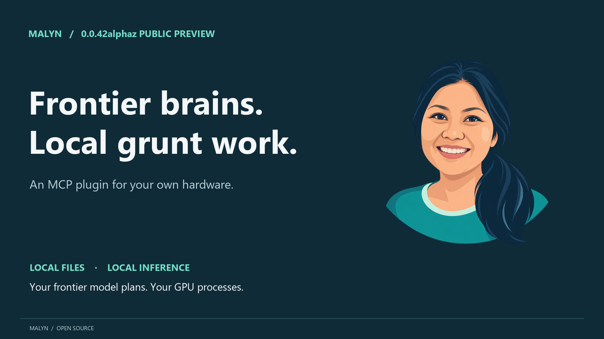

# Malyn

A local AI plugin for MCP agents. Give it a bounded task and file paths; it processes them on your hardware, saves a report and returns a generic completion note plus local artifact links by default.

Use Malyn to triage logs, describe images, extract facts across text files and draft code changes. Its model has no shell or connectors and cannot edit source files. Use your MCP agent for authorised file collection, detailed review and applying changes.

## 0.0.42alphaz public preview

[Download the Windows release](https://github.com/synops-one/malyn/releases/tag/v0.0.42alphaz) · [Watch the 67-second demo](https://github.com/synops-one/malyn/releases/download/v0.0.42alphaz/Malyn-0.0.42alphaz-landscape.mp4)

[](https://github.com/synops-one/malyn/releases/download/v0.0.42alphaz/Malyn-0.0.42alphaz-landscape.mp4)

The package and installer use version **0.0.42**; the GitHub prerelease is labelled **0.0.42alphaz**. This early Windows preview has been tested on an Intel Arc B580. Fresh-account installation and GPU disconnect/reconnect testing remain unverified. The demo shows the 0.0.41 development UI with real product footage and synthetic inputs; processing waits are omitted and labelled.

## Tray, settings and administration

Version **0.0.42** includes a Windows tray icon and an on-demand local admin UI. The tray offers status, pause/resume and **Open Malyn**. The web interface has model settings, job/report history, shared loops, access boundaries and runtime limits. It binds only to `127.0.0.1`, uses a temporary authenticated session and stops after two minutes without UI activity. No web server runs just because the tray is open.

The installer starts the tray; use `Open-Malyn.cmd` to reopen it. You can enable sign-in startup in Preferences. If you're running from source, use `node bin/malyn.mjs tray` or `node bin/malyn.mjs ui`. Pause blocks new tasks; existing jobs finish normally. Malyn blocks model/settings changes until active jobs finish. See the [desktop guide](docs/desktop.md) for lifecycle, security and CLI controls. Restart your MCP clients after an upgrade to activate the new controls.

## Windows quick start

1. Download and extract [Malyn-0.0.42-Windows-x64.zip](https://github.com/synops-one/malyn/releases/download/v0.0.42alphaz/Malyn-0.0.42-Windows-x64.zip). Connect the GPU and install its vendor driver.
2. Run `Install-Malyn.cmd`. It starts `Install-Malyn.ps1`; command-line parameters are forwarded to that script.
3. Setup installs a private Node runtime, locates or downloads the LM Studio headless runtime, locates or downloads the model, performs a real file-to-artifact smoke test, and registers the MCP server and routing skill with Codex.
4. Restart Codex. Open Malyn from the new tray icon to review settings, then ask Codex to investigate a bounded set of files; the routing skill recommends Malyn when delegation is useful.

The default target is **Intel Arc B580 (12 GB), standard Gemma 4 12B QAT Q4_0, 64K context and Q8 KV cache, using LM Studio Vulkan on Windows**. The downloaded model with vision support is approximately 7.2 GB in decimal units; allow additional space for runtimes, archives, job data and future updates. Setup reuses your existing downloads and verifies real local inference before registering the worker. You can configure context up to the model/runtime limit; check memory usage before choosing a larger setting. Image inference, GPU Whisper transcription and multimodal embeddings have been tested on that B580 setup. Installation on a fresh machine has not yet been verified.

You can use the earlier B60 preset with `-Profile arc-b60`: standard Qwen3.8 27B Q4_K_M at 128K context. Ordinary upgrades keep your existing model/GPU settings. Pass `-Profile arc-b580` to switch to the B580 defaults; individual parameters still override them. You can configure other Vulkan GPUs/models, but they remain experimental.

```powershell
# Use an already downloaded model:
.\Install-Malyn.ps1 -ModelKey 'google/gemma-4-12b-qat'

# Switch an existing installation to the B580 defaults:
.\Install-Malyn.ps1 -Profile arc-b580

# Also download the GPU transcription and embedding components:
.\Install-Malyn.ps1 -Profile arc-b580 -WithComponents

# A different local model/GPU; select a context that fits your device:
.\Install-Malyn.ps1 -Profile custom -ModelKey 'your-local-model-key' -GpuPattern 'your GPU' -ContextLength 32768

# Install without changing Codex configuration:
.\Install-Malyn.ps1 -SkipRegister
```

The default installation directory is `%LOCALAPPDATA%\Malyn`. Launch `Malyn.cmd` there for CLI commands. Setup installs for your Windows account and does not install a GPU driver, reboot Windows or register a system service. Upgrades keep your configuration unless you override it, preserve previous app versions, and refuse to replace a running worker. Use `Remove-Malyn.ps1` to disconnect the registration and its unchanged routing skill. It keeps your models, runtimes, configuration and job results, and reports their locations.

To move your Malyn configuration to a new installation directory, use `Install-Malyn.ps1 -MigrateFrom 'C:\path\to\Malyn' -InstallDir 'D:\Apps\Malyn'`. Setup preserves your configured model and runtime settings, verifies the new app, and registers its new location. Your previous jobs stay in their original directory. See [moving and upgrading Malyn](docs/migration.md).

## Source and CLI

### Ask Malyn from Explorer

Enable **Add Ask Malyn to the file right-click menu** in Models & settings → Preferences, or install with `-WithExplorer`. Right-click one text/code file or PNG/JPEG/WebP image and choose **Show more options → Ask Malyn** on Windows 11. The local job view opens with progress and a link to an enriched summary: overview, key facts, supported concerns and next steps. It uses the configured general model (Gemma 4 12B by default), loading it if necessary. Only that selected file is readable by the worker; sibling files are excluded in code. No source is modified.

This first version accepts UTF-8 text/code up to 2 MB and images up to 10 MiB. Convert PDF, Office documents, archives and other binary formats before submitting them. Ask Malyn does not upload your file to a cloud agent. If Malyn is busy or paused, it tells you; it does not queue the task. CLI equivalents: `Malyn.cmd ask C:\inputs\note.txt` and `Malyn.cmd explorer on|off|status`.

### Screenshot mode

Turn **Screenshot mode** on in the tray or Preferences, then copy a screenshot with Windows Snipping Tool. While the tray runs, a new clipboard image is saved locally and analysed with the configured vision model. Malyn requests a Windows notification when analysis finishes; click it to open the job/report. Windows notification settings and Do not disturb can suppress the notification.

The mode is off by default. It watches new clipboard images, including images copied from other apps; it does not read clipboard text or capture the screen on a timer. Enabling it ignores the existing clipboard image. Busy/paused workers skip new images and notify you to copy again when ready. Switching it off stops future submissions; an active job can finish. Captures and reports remain local until you delete them. See [desktop controls](docs/desktop.md) for storage and access settings.

Use Node 22+ and npm. LM Studio with a compatible runtime and downloaded model must already be installed for source setup.

```powershell
npm ci --ignore-scripts
node bin/malyn.mjs setup
node bin/malyn.mjs doctor
node scripts/smoke.mjs
node bin/malyn.mjs submit --root C:\src\project --file README.md --task "Read README.md. Save setup-review.md with up to five concrete setup issues and source line numbers."
node bin/malyn.mjs check JOB_ID
node bin/malyn.mjs cancel JOB_ID
node bin/malyn.mjs jobs
```

`--config PATH` or `MALYN_CONFIG` selects another configuration. `setup --profile custom --model KEY --gpu-pattern REGEX --context 32768` configures a custom profile. `setup --no-probe` only writes a config; it does not establish runtime compatibility. `doctor` checks hardware/runtime/model availability; only the smoke test or a successful job verifies inference.

For a manual Codex connection, use absolute paths:

```powershell
codex mcp add malyn -- node C:\src\malyn\bin\malyn.mjs serve
```

Copy `skills/malyn-worker` into your Codex skills directory for automatic routing guidance. Alternatively, load the root plugin metadata with a compatible plugin host after installing dependencies and running setup. Enable one registration route at a time. The portable plugin manifest follows the [Agent Plugins format](https://developers.openai.com/plugins/build/plugins); plugin installation still depends on the client. The Windows installer uses direct MCP registration.

The [Malyn skill](skills/malyn-worker/SKILL.md) teaches Codex to choose useful work automatically and assemble a small task contract: objective, inputs, scope, output format, evidence and acceptance checks. It includes log-triage and code-draft examples, job supervision and result validation. The contract lives in the existing `task` argument; it does not require another service or protocol.

## Contract and limits

The `malyn` MCP tool supports asynchronous `submit`, `check` and `cancel`, runtime `status`, loop discovery/installation, local model listing and supported configuration changes. Submit a task or loop name, an absolute root and optional relative files/images. It returns a job ID immediately. By default, checks return a generic note and artifact paths, keeping generated details local. Set `returnMode: "summary"` to opt into generated summary text. Only `completed` is a finished run; `failed`, `cancelled`, `interrupted` and `incomplete` need attention. One job runs per config directory.

Reads are bounded by paths, file size, tool-call count and a tokenizer-based context budget. Set `allowedRoots` to restrict the task roots your agent can choose. Common secret names and links are excluded, but this is not an OS sandbox or comprehensive secret scanner. Results and any artifacts your cloud agent reads may enter its cloud context. See [security boundaries](SECURITY.md).

Local prompt/generated tokens and decode speed are reported per job. They are not measured cloud tokens or quota saved. Small tasks and repeated corrections can erase the benefit. See [measurement](docs/measurement.md), [configuration](docs/configuration.md) and [synthetic examples](examples/README.md).

Malyn includes five shareable Markdown **loops**:

- [ask-malyn](loops/ask-malyn.md): an enriched summary of one selected file, with key facts, supported concerns and next steps.
- [windows-system-logs](loops/windows-system-logs.md): collect a bounded Windows event snapshot and save a local triage report.
- [describe-my-image](loops/describe-my-image.md): describe supplied images with the local vision model.
- [transcribe-audio](loops/transcribe-audio.md): transcribe a WAV recording using Whisper Base on the configured GPU.
- [embed-local-files](loops/embed-local-files.md): generate local text/image vectors with Qwen3-VL-Embedding-2B on the configured GPU.

Each declares its model requirements and output checks. Optional components download only when you choose to install them, load when their loop runs and unload afterwards. Malyn unloads its own idle general model to make room; the next general task reloads it. CPU and remote fallback are disabled. The [component guide](docs/components.md) covers installation, input limits and upstream sources; the [loop guide](docs/loops.md) covers sharing, MCP controls and report links.

```powershell
node bin/malyn.mjs loops
node bin/malyn.mjs loop windows-system-logs
node bin/malyn.mjs submit --loop describe-my-image --root C:\inputs --image photo.png
```

Codex and Claude Code support local stdio MCP servers. The Windows installer registers Codex. To connect [Claude Code](https://code.claude.com/docs/en/mcp), use `claude mcp add --transport stdio malyn -- node C:\src\malyn\bin\malyn.mjs serve --config C:\path\malyn.config.json`. Use the installed private Node path if Node is not on PATH. Claude Code compatibility follows the standard MCP interface; a live Claude client has not been validated in this release. If you use another client, it needs local file/collection access to carry out the loop's supervisor steps.

## Development and release

Run `npm test`, `npm run licenses` and `npm run release:check`. On Windows, `pwsh -File scripts/Build-Package.ps1` builds a clean source ZIP, npm tarball, Windows ZIP and SHA-256 manifest. See [release steps](docs/releasing.md) for fresh-machine validation and publishing. Nothing in the build publishes externally.

Original Malyn code is MIT licensed. Bundled dependencies retain their notices in `LICENSES/` and `THIRD_PARTY_NOTICES.md`. LM Studio, optional native runtimes and model weights are separate downloads with their own licenses and terms. General inference uses LM Studio; optional Whisper and embedding processors use pinned Vulkan builds. A general-purpose direct llama.cpp/SYCL backend remains future work.
